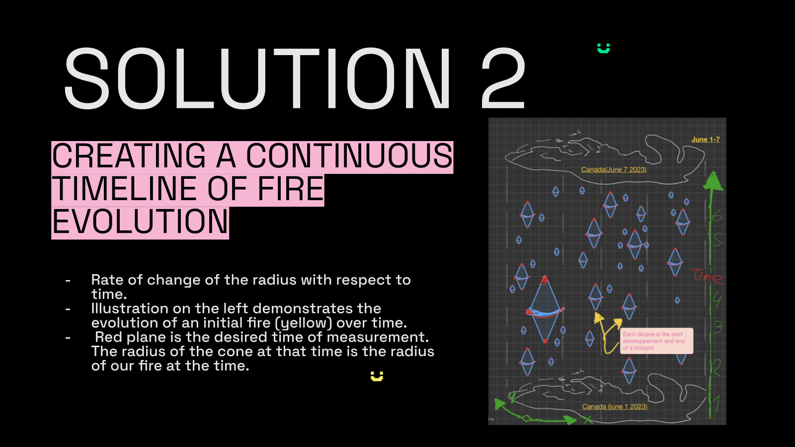
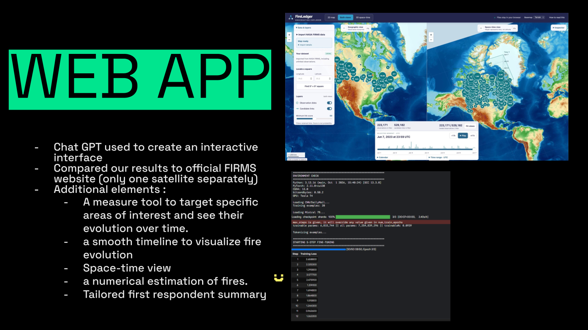
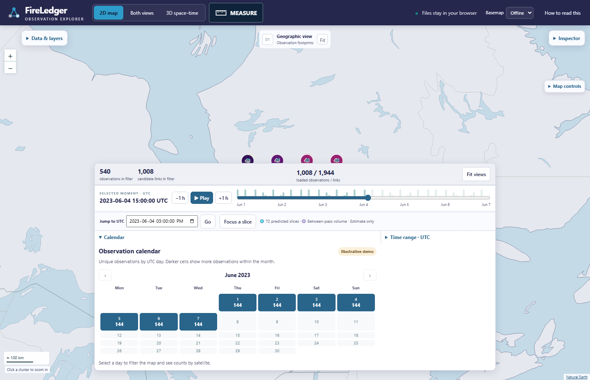
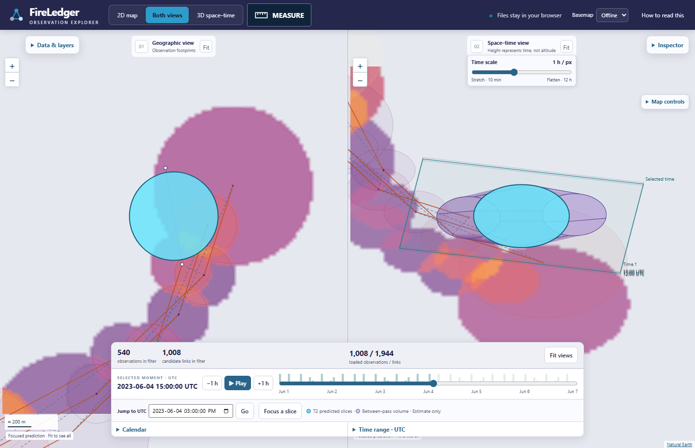
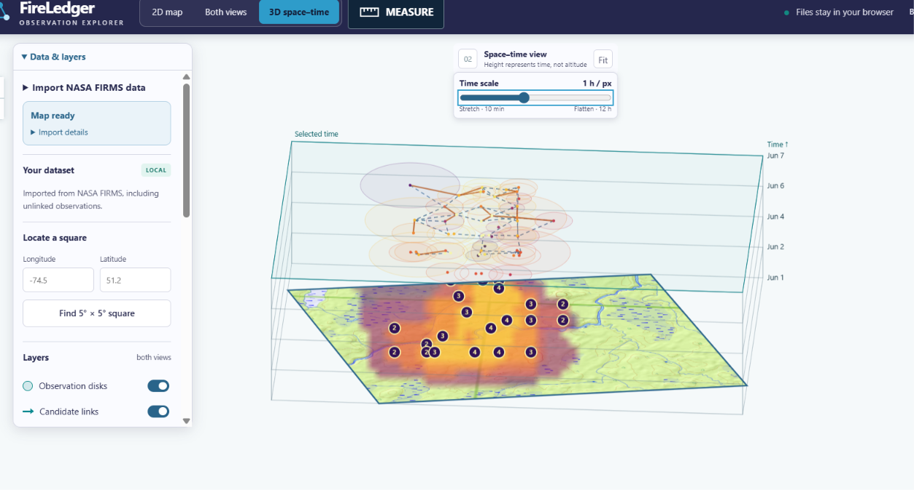

# FireLedger

FireLedger is a browser-based explorer for the NASA Space Apps Challenge on MODIS and VIIRS harmonization. It maps satellite fire detections in Canada, finds candidate links between passes, and lets you explore where detections recur and how a linked footprint could change between observations.

## How FireLedger works

MODIS and VIIRS observe fires with different pixel sizes and at different times. We put their detections in a common format while keeping each footprint’s size, timestamp, and satellite. The resulting disks are the building blocks for the 2D map and the 3D space–time view.

### 1. Identify and prepare the input

For a local import, FireLedger reads one raw CSV per FIRMS ZIP and identifies the product from its archive name and records. The acquisition timestamps come from the rows. For an API import, FireLedger checks Standard Processing coverage first, then downloads data in batches of up to five days per product and retains points inside or on the Canada boundary. Terra and Aqua share a single MODIS download when both are selected.

### 2. Normalize observations and make disks

The formatter combines both instruments into a master CSV with eight columns:

```text
longitude,latitude,datetime_utc,radius_km,brightness_k,confidence_raw,type,source_id
```

It joins the acquisition date and zero-padded time into a UTC timestamp. MODIS uses the reported brightness field, and VIIRS uses its I4 brightness temperature (`bright_ti4`). The formatter retains the source and confidence and marks missing detection types as unknown.

Each detection becomes a disk centered on its reported longitude and latitude. For scan and track dimensions in kilometers, the disk radius is **√(scan × track / π)**. This gives the circle the same area as the approximate rectangular pixel footprint and allows for variable pixel sizes. The disk represents the satellite’s detection footprint. Fire perimeter and burned area require other measurements.

| Source ID | Satellite | Instrument |
| --- | --- | --- |
| 0 | Terra | MODIS |
| 1 | Aqua | MODIS |
| 2 | Suomi NPP | VIIRS |
| 3 | NOAA-20 | VIIRS |
| 4 | NOAA-21 | VIIRS |

### 3. Split by location and month

The master CSV is divided into **5° longitude × 5° latitude × one UTC month** tiles. The linker reads those tiles, orders detections by time, and excludes exact duplicate records from matching. It searches nearby recent detections with a spatial index, so candidates can cross tile boundaries.

### 4. Score links between satellite passes

For each later detection, the linker considers earlier disks from the previous **6 hours**, with a **30-minute minimum** for pairs from the same satellite. It rejects conflicting known detection types. It calculates the great-circle distance between the centers, subtracts the two radii, and checks whether the remaining gap fits the model allowance. That allowance is **0.5 km + 2 km/h × elapsed hours**. Known static-source associations use only the 0.5 km padding.

The score combines spatial support (**45%**), temporal support (**25%**), sensor confidence (**20%**), and detection-type agreement (**10%**). Spatial support falls as the center distance grows relative to the combined radii and allowance. Temporal support decays exponentially with a three-hour time scale. MODIS numeric confidence and VIIRS low, nominal, and high confidence are scaled before the pair is scored. Unknown types receive partial type support.

The linker keeps up to **three** outgoing candidates per observation scoring at least **50/100** and ranks the strongest first. The scores describe heuristic compatibility. A rejected link leaves the detections unlinked, and even the strongest retained link needs independent evidence to establish that both detections came from the same fire.

### 5. Draw the space–time volume and take a slice

Our prototype stacked observed disks along a vertical time axis and used cone-like geometry to describe change between passes. The app connects eligible pairs with two tapered sections. They meet the measured footprints at both ends and allow limited modeled widening between them. The center advances in proportion to elapsed time along the candidate link. A horizontal cut at the selected UTC time gives the cyan slice shown on the 2D map and in the 3D view.

Only eligible vegetation-fire or unclassified detections contribute to the model. Static-source links are excluded. Each slice uses two existing observations and describes an estimate within that interval.



*Original space–time geometry sketch from our design presentation.*

### 6. Compare modeled progression with repeat detections

Thermal overlap uses the observations directly. It scales brightness per satellite and groups detections from the same satellite into 30-minute windows within each map cell. The strongest reading from each window contributes to the thermal color. The numbered badges show estimated repeat-pass counts, and the Inspector gives first and latest detection times. The user can compare these observations with the separately modeled cyan slices.



*Early web interface prototype from the same presentation.*

[FireLedger design presentation](https://docs.google.com/presentation/d/19QAzI4S_RdidE5Zqw5E18RgPHsGQqN4pUDCTLKq5xLo/edit)

## Open FireLedger

- **Online.** Open [FireLedger on GitHub Pages](https://spacedivee.github.io/FireLedger/).
- **From your computer.** [Download the repository ZIP](https://github.com/spacedivee/FireLedger/archive/refs/heads/main.zip), extract it, and open `index.html` in a current browser such as Chrome or Edge. The app includes the demo and an offline basemap. Live FIRMS imports and online map tiles need internet access.

Close the welcome dialog to explore the built-in **DEMO** dataset without a key. The screenshots below use illustrative Québec detections from that demo.

## Import your own data

1. [Request a free NASA FIRMS MAP_KEY](https://firms2.modaps.eosdis.nasa.gov/api/map_key/). NASA sends it by email.
2. Open **Data & layers → Import NASA FIRMS data** and paste your key.
3. Choose the **start** and **end** dates in UTC. The import includes both dates. Select one or more satellites from Terra and Aqua (MODIS) or Suomi NPP, NOAA-20, and NOAA-21 (VIIRS).
4. Click **Import and map detections**. Use the progress bar to track the import and expand **Import details** for individual stages, errors, and available CSV downloads. **Cancel processing** stops an import in progress.

The API import uses Canadian **Standard Processing** detections. FireLedger sends the key directly to NASA and runs the processing in your browser. If NASA reports that a date is unavailable, choose dates covered by the selected products. Larger ranges take longer to download and process.

For existing NASA FIRMS archives, expand **Import from local ZIPs → Choose FIRMS ZIPs** and select your archives together. Each ZIP should contain one FIRMS archive CSV. FireLedger normalizes the sensor fields, partitions detections into 5° × 5° monthly tiles, and builds the candidate links used by the viewer.


## Navigate and inspect the map

Choose **2D map**, **Both views**, or **3D space–time** in the masthead. Drag to pan in 2D. In 3D, drag to rotate or tilt and Shift-drag or right-drag to pan. Scroll or use **+ / −** to zoom. Touch users can pinch to zoom. **Fit views** resets the framing. The desktop **Map controls** panel lists the shortcuts, including **F** to fit the active view and **Esc** to clear a selection.

- **Basemap** switches between Terrain, Streets, and the offline map.
- **Locate a square** highlights the 5° × 5° tile containing a longitude and latitude.
- **Observation disks** show the approximate satellite footprints. Click a disk for its satellite, acquisition time, brightness, and location. At wide zooms, observations are grouped. Click a cluster to zoom in.
- **Candidate links** show possible associations between detections. Click one for its endpoint observations, elapsed time, distance, and score. Raise **Minimum link score** to show fewer candidates. Link scores are heuristic.

## Choose a time

Drag the timeline, step by an hour with **−1 h / +1 h**, or click **Play**. Enter a timestamp in **Jump to UTC** and press **Go** for an exact time.

- **Calendar** shows daily counts. Select a day to load its UTC time window and see the counts by satellite. Use the month arrows to browse.
- **Time range · UTC** sets a custom display window over data already loaded. Its end timestamp is excluded. Reset the dates to return to the entire loaded window.
- In **3D space–time**, the vertical axis represents time. Move **Time scale** toward **10 min/px** to stretch time or **12 h/px** to flatten it.



## Read thermal overlap

Enable **Thermal overlap** in **Data & layers**. On the ground map, purple shifts toward orange and yellow as brighter readings and more detection windows overlap. Brightness is relative to the readings from each satellite in the loaded data. At broad zooms, one map cell can contain nearby detections.

Click a **numbered badge**, or Shift-click a heat cell on desktop, to see the estimated repeat-pass count, satellites, first and latest detection times, and relative brightness. Detections from the same satellite within a 30-minute cell window contribute their strongest reading. Repeat detections indicate renewed observation of an area. Activity between those passes is unknown.


## Explore progression between passes

Enable **Between-pass predictions** and choose **Both views**. The violet 3D volume joins eligible candidate footprints, and its cyan cross-section shows the estimated footprint at the selected UTC time in both views. Scrub the timeline to move that slice. Click a slice or volume to inspect the link and estimated distance along it.

Use **Focus a slice** to isolate a candidate. **Find a slice** jumps to an eligible time if the selected moment has none. **Fit views** restores the overview. The model interpolates between two existing observations and uses modeled widening between them. Its output is an estimate of a candidate connection, with no projection beyond the linked observations.



## Measure and isolate an area in 3D

### Draw the boundary

1. Open **2D map** in the masthead and zoom in on the area you want to study. Click **Measure** and select **Area**.
2. Click the map to place boundary points in order. Place at least three points and trace around the region. Click the **first point** again to close the outline. In **Area** mode, you can also double-click the last point or press **Enter** to finish.
3. Open **Total Area** if the results are collapsed. Use **Units** to switch between acres, hectares, square kilometers, and square miles. To remove one result, click its **×**. **Clear** removes all measurements. Use **Pan** to move around without adding boundary points.
4. You can also draw with **Distance**. Use it for an open path in kilometers or miles. To use that path as an area boundary, place at least three points and click the **first point** again to close the loop.


### Show only that area in space–time

1. In the results, click **View this area** next to the closed outline you want. FireLedger fits the outline and filters the basemap and observations to it. Candidate links require both endpoints to be inside, and the timeline and calendar update for the selected area.
2. Select **3D space–time** in the masthead. Choose **Both views** if you want to compare the same outline in 2D and 3D side by side.
3. Drag to rotate or tilt, Shift-drag or right-drag to pan, and scroll to zoom. Use **Time scale** to spread the time layers toward **10 min/px** or flatten them toward **12 h/px**. Height represents UTC time. Use the timeline to move the selected time through the area.
4. When you’re done, click **Show full map**. If the timeline is collapsed, you can also use **Expand timeline** to bring back the scrubber and calendar.



## Team

- David Dajbog
- Zhuoxuan Ma
- Sami Alex Benhadid
- Ariya Monfaredneirizi
- Ethan Pei
- Ryan Njoumene

## Data and map credits

- Fire observations and satellite products come from [NASA FIRMS](https://firms.modaps.eosdis.nasa.gov/).
- Basemap credits appear on the map. Terrain uses [OpenTopoMap](https://opentopomap.org/) and SRTM, Streets uses [OpenStreetMap](https://www.openstreetmap.org/copyright), and the offline map uses [Natural Earth](https://www.naturalearthdata.com/).
