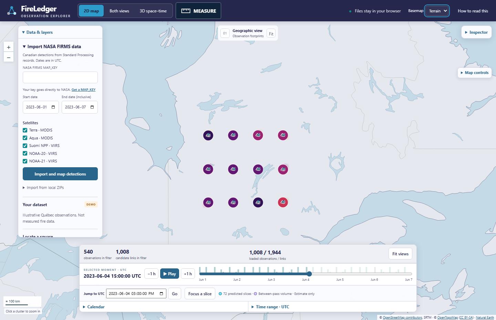
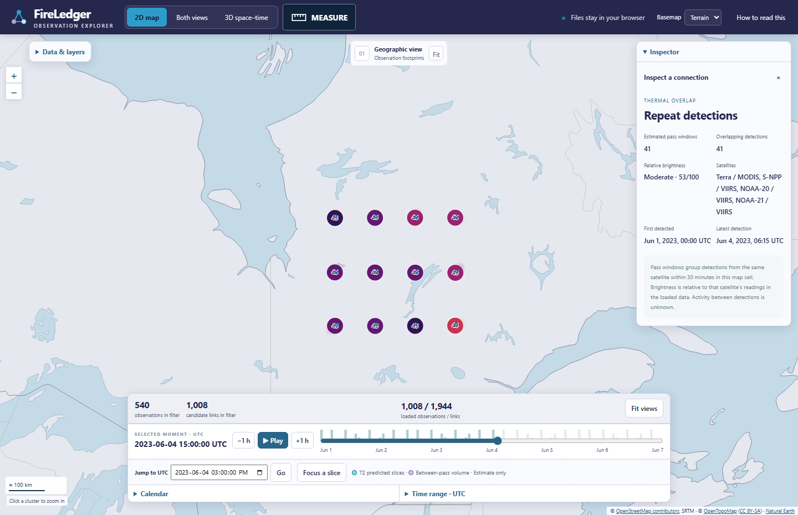
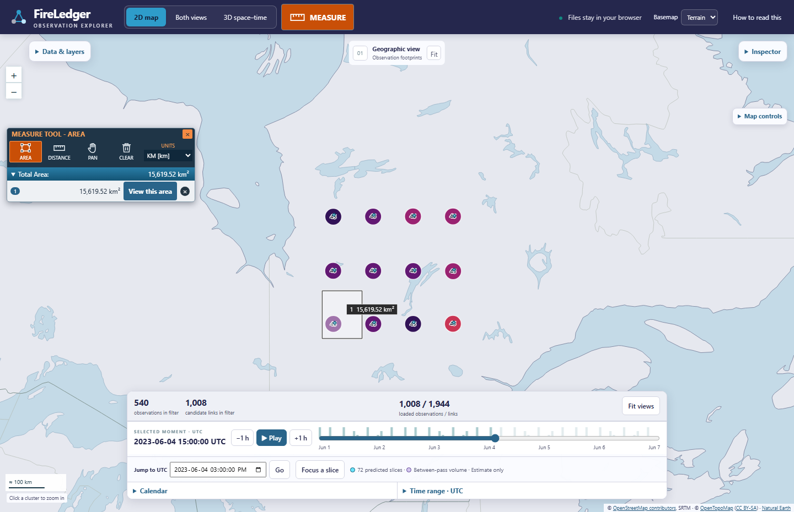

# FireLedger

FireLedger is a browser-based explorer for the NASA Space Apps Challenge on MODIS and VIIRS harmonization. It maps satellite fire detections in Canada, finds candidate links between passes, and lets you explore where detections recur and how a linked footprint could change between observations.

## Open FireLedger

- **Online.** Open [FireLedger on GitHub Pages](https://spacedivee.github.io/FireLedger/).
- **From your computer.** [Download the repository ZIP](https://github.com/spacedivee/FireLedger/archive/refs/heads/main.zip), extract it, and open `index.html` in a current browser such as Chrome or Edge. The app includes the demo and an offline basemap. Live FIRMS imports and online map tiles need internet access.

Close the welcome dialog to explore the built-in **DEMO** dataset without a key. The screenshots below use illustrative Québec detections from that demo.

## Import your own data

1. [Request a free NASA FIRMS MAP_KEY](https://firms2.modaps.eosdis.nasa.gov/api/map_key/). NASA sends it by email.
2. Open **Data & layers → Import NASA FIRMS data** and paste your key.
3. Choose the **start** and **end** dates in UTC. The import includes both dates. Select one or more satellites from Terra and Aqua (MODIS) or Suomi NPP, NOAA-20, and NOAA-21 (VIIRS).
4. Click **Import and map detections**. Use the progress bar to track the import and expand **Import details** for individual stages, errors, and available CSV downloads. **Cancel processing** stops an import in progress.

The API import uses Canadian **Standard Processing** detections. FireLedger sends the key directly to NASA and runs the processing in your browser. If NASA reports that a date is unavailable, choose dates covered by the selected products. Larger ranges take longer to download and process.

For existing NASA FIRMS archives, expand **Import from local ZIPs → Choose FIRMS ZIPs** and select your archives together. Each ZIP should contain one FIRMS archive CSV. FireLedger normalizes the sensor fields, partitions detections into 5° × 5° monthly tiles, and builds the candidate links used by the viewer.

## Navigate and inspect the map

Choose **2D map**, **Both views**, or **3D space–time** in the masthead. Drag to pan in 2D. In 3D, drag to rotate or tilt and Shift-drag or right-drag to pan. Scroll or use **+ / −** to zoom. Touch users can pinch to zoom. **Fit views** resets the framing. The desktop **Map controls** panel lists the shortcuts, including **F** to fit the active view and **Esc** to clear a selection.

- **Basemap** switches between Terrain, Streets, and the offline map.
- **Locate a square** highlights the 5° × 5° tile containing a longitude and latitude.
- **Observation disks** show the approximate satellite footprints. Click a disk for its satellite, acquisition time, brightness, and location. At wide zooms, observations are grouped. Click a cluster to zoom in.
- **Candidate links** show possible associations between detections. Click one for its endpoint observations, elapsed time, distance, and score. Raise **Minimum link score** to show fewer candidates. Link scores are heuristic.

## Choose a time

Drag the timeline, step by an hour with **−1 h / +1 h**, or click **Play**. Enter a timestamp in **Jump to UTC** and press **Go** for an exact time.

- **Calendar** shows daily counts. Select a day to load its UTC time window and see the counts by satellite. Use the month arrows to browse.
- **Time range · UTC** sets a custom display window over data already loaded. Its end timestamp is excluded. Reset the dates to return to the entire loaded window.
- In **3D space–time**, the vertical axis represents time. Move **Time scale** toward **10 min/px** to stretch time or **12 h/px** to flatten it.

## Read thermal overlap

Enable **Thermal overlap** in **Data & layers**. On the ground map, purple shifts toward orange and yellow as brighter readings and more detection windows overlap. Brightness is relative to the readings from each satellite in the loaded data. At broad zooms, one map cell can contain nearby detections.

Click a **numbered badge**, or Shift-click a heat cell on desktop, to see the estimated repeat-pass count, satellites, first and latest detection times, and relative brightness. Detections from the same satellite within a 30-minute cell window contribute their strongest reading. Repeat detections indicate renewed observation of an area. Activity between those passes is unknown.

## Explore progression between passes

Enable **Between-pass predictions** and choose **Both views**. The violet 3D volume joins eligible candidate footprints, and its cyan cross-section shows the estimated footprint at the selected UTC time in both views. Scrub the timeline to move that slice. Click a slice or volume to inspect the link and estimated distance along it.

Use **Focus a slice** to isolate a candidate. **Find a slice** jumps to an eligible time if the selected moment has none. **Fit views** restores the overview. The model interpolates between two existing observations and uses modeled widening between them. Its output is an estimate of a candidate connection, with no projection beyond the linked observations.

## Measure and isolate an area

1. Click **Measure** in the masthead and choose **Area** or **Distance**.
2. Click points on the map. Return to the first point to close a loop, or double-click the last point or press **Enter** to finish. Choose the measurement units in the tool.
3. For a closed outline, click **View this area** beside the result. The map and data views focus on the outline and the timeline and calendar update to reflect the selected area.
4. Click **Show full map** to restore the full extent. **Pan** temporarily lets you navigate without adding points, and **Clear** removes the measurements.

## Team

- David Dajbog
- Zhuoxuan Ma
- Sami Alex Benhadid
- Ariya Monfaredneirizi
- Ethan Pei
- Ryan Njoumene

## Data and map credits

- Fire observations and satellite products come from [NASA FIRMS](https://firms.modaps.eosdis.nasa.gov/).
- Basemap credits appear on the map. Terrain uses [OpenTopoMap](https://opentopomap.org/) and SRTM, Streets uses [OpenStreetMap](https://www.openstreetmap.org/copyright), and the offline map uses [Natural Earth](https://www.naturalearthdata.com/).
